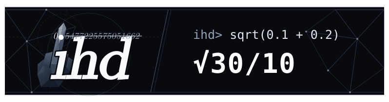

# i-hate-decimal-calc / ihd

<p align="center">
  
</p>

A command-line Computer Algebra System (CAS) calculator that rejects all decimal approximations, immediately converting every decimal input into exact arbitrary-precision rationals (`big.Rat`) and computing symbolically over radicals, constants, p-adic expansions, Puiseux series, and rational intervals.


[](https://github.com/DovahkiinYuzuko/i-hate-decimal-calc/actions/workflows/lean-verify.yml)
[](https://github.com/DovahkiinYuzuko/i-hate-decimal-calc/actions/workflows/typst-verify.yml)
[](./LICENSE.MIT)

[日本語](README.md) | [English](README.en.md)

## Table of Contents

- [Why ihd? (Elimination of Decimals & Exact Algebraic Computation)](#why-ihd-elimination-of-decimals--exact-algebraic-computation)
- [Installation](#installation)
- [Quick Start & Execution Modes](#quick-start--execution-modes)
- [Feature Highlights](#feature-highlights)
- [Syntax & Functions Reference](#syntax--functions-reference)
- [Command-Line Options & Subcommands](#command-line-options--subcommands)
- [Development & Testing](#development--testing)
- [Practical Problem Cookbook (Exam & Cookbook)](#practical-problem-cookbook-exam--cookbook)
- [LICENSE](#license)

### Why ihd? (Elimination of Decimals & Exact Algebraic Computation)

Standard programming languages and calculators rely on `float64` floating-point numbers, introducing rounding errors and truncating irrational or transcendental values into finite decimals.

`ihd` (i-hate-decimal-calc) is a command-line Computer Algebra System (CAS) calculator built on the strict philosophy of **"Never tolerate decimals."** All decimal inputs are converted into exact arbitrary-precision rational fractions (`big.Rat`) during lexical analysis. Radicals, trigonometric functions, logarithms, transcendental constants, imaginary units, p-adic expansions, Puiseux series, and closed rational intervals are preserved as first-class symbolic AST nodes and simplified using algebraic rewrite rules.

| Input Expression      | Typical Calculators / Languages (`float64`) | `ihd` (Exact Calculation) | Simplification Behavior                                             |
| :-------------------- | :------------------------------------------ | :------------------------ | :------------------------------------------------------------------ |
| `0.1 + 0.2`           | `0.30000000000000004`                       | `3/10`                    | Zero-error exact rational fraction                                  |
| `0.(3)`               | `0.3333333333333333`                        | `1/3`                     | FSM lexical analysis converts repeating decimals to exact fractions |
| `sqrt(8)`             | `2.8284271247461903`                        | `2*√2`                    | Automatic extraction of perfect squares                             |
| `sqrt(5 + 2*sqrt(6))` | `3.1462643699419726`                        | `√2 + √3`                 | Automatic radical denesting via Borodin (1985) algorithm            |
| `1 / (sqrt(2) + 1)`   | `0.4142135623730951`                        | `-1 + √2`                 | Binomial conjugate radical rationalization                          |
| `sin(pi/6)`           | `0.49999999999999994`                       | `1/2`                     | Exact algebraic evaluation of special angles                        |
| `１＋２×３`           | Error (Unsupported)                         | `7`                       | Automatic normalization of Zenkaku characters to ASCII              |

> [!WARNING]
> **Mathematical Exactness & External Verification (Important Notice)**:  
> While `ihd` strictly rejects decimal approximations and maintains exact symbolic representations, it does **not** guarantee 100% mathematical flawlessness across all mathematical domains. Due to the inherent algorithmic complexities of Computer Algebra Systems (CAS) and active ongoing development, `ihd` may occasionally produce incorrect, incomplete, or partially reduced results—particularly in advanced integration, limits, or equation solving. Additionally, integer factorization of large composites uses deterministic work-budget bounds; when the budget is exceeded, `factor` returns a partial factorization preserving the discovered prime factors alongside any unfactored composite remainder.  
> Currently, this repository continuously runs automated pipelines in GitHub Actions CI for **Unit Tests (`unit-test.yml`)**, **Lean 4 Kernel Formal Verification (`lean-verify.yml`)**, **Typst Math Compilation (`typst-verify.yml`)**, and **Mathematical Invariants Fuzzing (`fuzz-smoke.yml`)**. Expressions and theorems included within the CI test suite are mechanically verified and guaranteed. However, calculations outside of these explicit suites may be subject to bugs or omissions.  
> To address this, `ihd` prioritizes **external verifiability** over blind trust. We actively develop verifiable pipelines including **automated reverse-verification (`--verify`)**, **proof certificates (`--certificate`)**, a **standalone micro-verifier (`tools/micro-verifier`)**, and formal theorem transpilation to **Lean 4 (`--lean`)**. For critical research or mission-critical calculations, please verify results independently with external tools.

<details>
<summary><b>Logo Trivia</b></summary>

- **Defying the Decimal Point**: In the top banner, the dot of the `i` in `ihd` shares the exact coordinates (`cx=125.2, cy=76.8`) with the decimal point `.` of `0.5477225575051662`—where the infinite irrational expansion `0.54772255750516611345...` of `sqrt(0.1 + 0.2)` is truncated at the 16th decimal place and rounded from `...1661` to `...1662`—and is struck out from below by a low-poly middle finger in the background layer. In stark contrast, the right side displays `ihd`'s exact rationalized result, `√30/10`.
- **Layout Coordinates Solved by `ihd` Itself**: Given the rendered bounding-box widths of the left typography (`164px`) and the right REPL output (`302px`), the four horizontal coordinates $[L_{\min}, X_{\text{div}}, R_{\min}, X_{\text{right}}]$ that equalize both the outer frame margins (from left border `x=10`) and the inner margins around the central diagonal divider were computed directly using `ihd`'s own linear system solver `linsolve`:
  ```text
  ihd> linsolve([[1, 0, 1, -1], [1, -2, 1, 0], [1, 0, 0, 0], [0, 1, 0, 0]], [-292, -164, 100, 330])
  [100, 330, 396, 788]
  ```
</details>

---

### Installation

#### One-line Installer (Recommended)

**Linux / macOS (bash / zsh):**
```bash
curl -fsSL https://raw.githubusercontent.com/DovahkiinYuzuko/i-hate-decimal-calc/main/install.sh | bash
```

**Windows (PowerShell):**
```powershell
irm https://raw.githubusercontent.com/DovahkiinYuzuko/i-hate-decimal-calc/main/install.ps1 | iex
```

> [!NOTE]
> **Android (Termux) & Login Shell Environments**:  
> In environments like Termux on Android, `~/.bash_profile` is evaluated primarily upon session startup instead of `~/.bashrc`. To persist the `PATH` environment variable across sessions, append `export PATH="$HOME/.ihd/bin:$PATH"` to your `~/.bash_profile`, or ensure `~/.bashrc` is sourced within `~/.bash_profile` (`[ -f ~/.bashrc ] && . ~/.bashrc`).

#### Building from Source

Requires Go 1.26.5. Build directly from the root of the repository:

```bash
go build -o ihd ./cmd/ihd
```

---

### Quick Start & Execution Modes

#### 1. One-shot Calculation
Provide expressions directly as command-line arguments for instant exact evaluation:

```bash
# Exact rational arithmetic
ihd "1/2 + 1/3"
# Output: 5/6

# Exact algebraic equivalence & nested radicals
ihd "sqrt(2) + sqrt(3) == sqrt(5 + 2*sqrt(6))"
# Output: true

# Real algebraic inequality solving (CAD / Sturm root isolation)
ihd "solve(x^2 - 4 < 0)"
# Output: [[-2, 2]]
```

#### 2. Interactive REPL
Running without arguments launches the interactive REPL with command history, navigation, and full IME support:

```text
$ ihd
ihd: Exact Arithmetic Calculator
Type 'exit' or 'quit' to exit.
ihd> 1/2 + 1/3
5/6
ihd> ans * 6
5
ihd> x = 1 + sqrt(2)
1 + √2
ihd> exit
Goodbye.
```

#### 3. Piped Input (Batch Integration)
Process expressions sequentially from standard input. Variable states persist across lines within the same piped session:

```bash
echo "sin(pi/6)^2 + cos(pi/6)^2" | ihd
# Output: 1

printf "x = 1/2 + sqrt(2)\nx * 2\n" | ihd
# Output:
# 1/2 + √2
# 1 + 2*√2
```

#### 4. Script Execution (`ihd run <file.ihd>`)
Execute `.ihd` text files containing multi-line variable definitions and calculations. Lines ending with a semicolon `;` suppress output display while still persisting variables:

```bash
ihd run sample.ihd
# Or direct invocation
ihd sample.ihd
```

#### 5. Full-width (Zenkaku) Normalization
Automatically normalizes full-width digits, letters, operators (`＋`, `−`, `×`, `÷`, `＾`, `！`, `＝`), parentheses, and spaces to half-width ASCII across all execution modes:

```bash
ihd "１＋２×３"
# Output: 7
```

---

### Feature Highlights

`ihd` is designed to combine algebraic exactness with external verifiability and practical terminal usability:

#### Exact Closed-Domain First-Class AST Nodes
- **Closed-Domain Arithmetic (`PadicNode` / `PuiseuxNode` / `IntervalNode`)**: Truncated p-adic series from `padic_expand`, Puiseux series from `puiseux`, and rational enclosures from `interval([low, high])` or `interval(expr)` are represented as first-class AST nodes rather than flat strings. Each domain supports closed arithmetic (`+`, `-`, `*`, `/`, integer powers), differentiation for Puiseux series, and exact relational comparisons for disjoint intervals. Mixed-prime or mixed-variable expressions safely preserve symbolic form or raise domain errors instead of silently approximating.
- **Deterministic Integer Factorization Pipeline (`factor`)**: Combines small trial division, perfect-power detection, Pollard-Brent rho, and deterministic Lenstra Elliptic Curve Method (ECM Stage 1 / Stage 2). When work budgets are exhausted on large composites, `factor` returns a partial factorization with the discovered prime factors and remaining unfactored factor so evaluation stays responsive and bounded.
- **Exact Rational Physical Units & Dimensional Analysis**: Implements exact dimensional calculus over the 7-dimensional vector space $\mathbb{Q}^7$ of SI base units, supporting unit multiplication, prefix scaling, and exact conversions (`convert_unit`).

#### Visualization, Interactivity & Safety
- **Derivation Step Trees & Formal Proofs (`--explain`)**: Visualizes exact transformation steps across rationalization, radical denesting, factoring, and limits (L'Hopital). From a single provenance DAG, it directly projects into **Typst documents (`--typst`)** or **Lean 4 transitive equational proofs (`--lean`)**.
- **Terminal 2D Pretty Printing (`--pretty`)**: Renders fractions, square roots, and matrices in multi-line ASCII/Unicode box-model typography.
- **Braille 2×4 Subpixel Terminal Plotter (`plot`)**: Uses Unicode Braille characters to plot function curves, extrema, and roots directly in terminal windows.
- **REPL Real-time Signature Guide & Syntax Highlighting**: Zero-dependency FSM provides real-time argument index indicators, localized signature tooltips, rainbow nested parentheses, and session variable highlighting.
- **Collection Manipulation & Lambdas**: Supports Python-style slicing (`[start:end:step]`), rational range sequences (`range`), first-class lambdas, and higher-order functions (`map`, `filter`).
- **Iteration Runaway Guard (`--warn-loop` / `--max-loop`)**: Protects against runaway CAS loops (`table`, `for`, `product`) with non-destructive `os.Stderr` warnings and hard cutoffs without corrupting standard output pipelines.

> [!TIP]
> For detailed visual examples, ASCII plots, derivation trees, and Typst/Lean4 outputs, see the **[Visual Samples & Showcases](./sample/sample.en.md)**.

---

### Syntax & Functions Reference

`ihd` provides exact symbolic functions spanning elementary algebra and calculus through number theory, real algebraic geometry, local series analysis, and formal proof verification:

| Mathematical Domain | Representative Functions |
| :--- | :--- |
| **Basic Algebra, Number Theory & Equations** | `expand`, `factor` (perfect-power check, Pollard-Brent rho, ECM), `apart`, `together`, `gcd`, `lcm`, `mod`, `is_prime`, `solve`, `cfrac`, `groebner`, `sturm`, `interval` |
| **Trigonometric, Logarithmic & Complex** | `sin`, `cos`, `tan`, `asin`, `acos`, `atan`, `trig_expand`, `trig_reduce`, `exp`, `log`, `ln`, `polar` |
| **Calculus, ODEs, Special Functions & Local Series** | `diff`, `integrate`, `limit`, `taylor`, `puiseux`, `dsolve`, `laplace`, `lambert_w`, `erf`, `gamma`, `sum` |
| **Linear Algebra, LP & Integer Normal Forms** | `det`, `inv`, `rank`, `rref`, `eigenvals`, `linsolve`, `lp_maximize`, `hnf`, `snf`, `lll` |
| **Computational Geometry & Automated Proving** | `line_intersect`, `circle_intersect`, `triangle_area`, `geo_prove` (Wu's method) |
| **Algebraic Structures, p-adic, Arithmetic Geometry & Quantum** | `padic_val`, `padic_norm`, `padic_expand`, `galois_group`, `is_solvable_by_radicals`, `ec_p_order`, `ec_rank_bound`, `clifford`, `quantum_equiv` |
| **Units, Assumptions & CAS Iteration** | `convert_unit`, `assume`, `unassume`, `table`, `range`, `map`, `filter` |

> [!TIP]
> For complete specifications, parameter definitions, mathematical explanations, and examples:  
> - **Markdown Edition**: [Japanese Reference](docs/references/ja/reference.ja.md) / [English Reference](docs/references/en/reference.en.md)  
> - **Offline Single-File HTML Edition**: [Japanese Reference (HTML)](docs/references/ja/reference.ja.html) / [English Reference (HTML)](docs/references/en/reference.en.html)

---

### Command-Line Options & Subcommands

#### Subcommands

| Command | Description & Examples |
| :--- | :--- |
| `ihd diff <f1\|e1> <f2\|e2>` | Compares two expressions or scripts to determine algebraic equivalence (`EQUIVALENT`) or changes (`CHANGED`).<br>`ihd diff "x^2 - 1" "(x - 1)*(x + 1)"` |
| `ihd run <file.ihd>` | Executes multi-line variable definitions and expressions from a script file.<br>`ihd run script.ihd` |
| `ihd completion <shell>` | Generates tab completion scripts for major shells (`bash`, `zsh`, `fish`, `powershell`).<br>`ihd completion powershell \| Out-String \| Invoke-Expression` |
| `ihd update` | Self-updates the binary to the latest GitHub release (`self-update` also accepted). |

#### Major CLI Options

| Option | Description & Examples |
| :--- | :--- |
| `-a`, `--approx` | Display arbitrary-precision `big.Float` approximation alongside exact results with interval enclosure error bounds (`±`).<br>`ihd -a "sqrt(2)"` |
| `--approx-digits <N>`, `--digits <N>` | Specifies decimal digits for approximation output (default: 30).<br>`ihd -a --digits 50 "sqrt(2)"` |
| `--format <fmt>` | Specify output format (`typst`, `latex`, `ascii`, `pretty`).<br>`ihd --format typst "1/2 + sqrt(2)"` |
| `--pretty` | Output expression in multi-line 2D pretty-printed Unicode typography.<br>`ihd --pretty "1/2 + sqrt(2)/2"` |
| `--typst` | Output expression in Typst math mode format (`$ ... $`).<br>`ihd --typst "1/2 + sqrt(2)"` |
| `--latex` | Output expression in LaTeX format (`$$ ... $$`).<br>`ihd --latex "1/2 + sqrt(2)"` |
| `--ascii` | Output using standard ASCII strings (`sqrt`, `pi`) instead of Unicode symbols.<br>`ihd --ascii "sqrt(2) + pi"` |
| `--explain` | Displays step-by-step algebraic derivation trees.<br>`ihd --explain "1 / (sqrt(2) + 1)"` |
| `--verify` | Reverse-verifies algebraic correctness by checking residual vanishing.<br>`ihd --verify "integrate(1/(x^2 + 1), x)"` |
| `-i`, `--interval` | Evaluates expressions using adaptive rational interval arithmetic enclosures.<br>`ihd -i "sin(1)"` |
| `--lean` | Transpiles calculation results into formal **Lean 4 (Mathlib4)** proof theorems.<br>`ihd --lean "factor(x^2 - 1)"` |
| `-h`, `--help` | Display categorized color-highlighted help message. |

<details>
<summary><strong>Expand Advanced & Execution Control Options (Click)</strong></summary>

| Option | Description & Examples |
| :--- | :--- |
| `--step` | Prints step-by-step algebraic transformations to stdout.<br>`ihd --step "expand((x+1)^3)"` |
| `--trace` | Outputs detailed AST rewrite traces and rule application logs.<br>`ihd --trace "factor(x^2 - 1)"` |
| `--certificate <file>` | Exports calculation steps and residuals into a certificate JSON file (`ihd-proof-trace-v1`).<br>`ihd --certificate cert.json "factor(x^2 - 1)"` |
| `--replay <file>` | Reads a certificate JSON file and verifies that residuals vanish.<br>`ihd --replay cert.json` |
| `--lean-file <path>` | Save generated Lean 4 proof code as a standalone `.lean` file.<br>`ihd --lean-file proof.lean "factor(x^2 - 1)"` |
| `--interval-eps <eps>` | Specifies maximum allowed enclosure tolerance for interval arithmetic.<br>`ihd -i --interval-eps 1/1000000 "sin(1)"` |
| `--deg` | Evaluate trigonometric functions in degrees.<br>`ihd --deg "sin(30)"` |
| `--theme <dark\|light\|none>` | Specify REPL color theme (persisted to `~/.ihd/config.json`).<br>`ihd --theme light` |
| `--lang <code/auto>` | Specify display language (`ja`, `en`, `auto`).<br>`ihd --lang en "1/2 + 1/3"` |
| `--timeout <dur>` | Sets wall-clock execution timeout (e.g. `2s`, `500ms`).<br>`ihd --timeout 2s "factor(x^100 - 1)"` |
| `--budget-steps <N>` | Maximum simplification step budget per rule pass.<br>`ihd --budget-steps 5000 "expand((x+1)^20)"` |
| `--max-nodes <N>` | Maximum allowed AST node count during expression tree expansion.<br>`ihd --max-nodes 10000 "expand((x+1)^10)"` |
| `--max-depth <N>` | Maximum recursion depth limit for symbolic rewrites.<br>`ihd --max-depth 200 "diff(x^10, x)"` |
| `--warn-loop <N>` | Warning threshold iterations for CAS loops (`table`, `for`, `product`, default: 1000). |
| `--max-loop <N>` | Hard limit cutoff for CAS loops (default: 100000). |
| `--deterministic` | Normalizes iterations and polynomial ordering for byte-identical outputs.<br>`ihd --deterministic "factor(x^4 - 5*x^2 + 4)"` |
| `--no-color` | Disables ANSI color sequence outputs. |
| `--no-update-check` | Disables automated checks for newer releases. |
| `-v`, `--version` | Displays version information. |

</details>

> [!NOTE]
> For the complete list of flags and options, see the [Complete Syntax Reference](docs/references/en/reference.en.md) or run `ihd --help`.

---

### Development & Testing

Developers who clone this repository can run tests and verifications using the following standard commands:

#### 1. Unit Tests
Runs standard Go unit tests across all packages:
```bash
go test ./...
```

#### 2. Mathematical Invariants Property-Based Testing & Fuzzing
Executes the fuzzing harness with exact multi-point evaluation oracles over Gaussian rationals $\mathbb{Q}[i]$:
```bash
# Smoke test all seed corpora and oracle tests
go test -v ./internal/calc -run "^(Fuzz|TestOracle|TestProvider)"

# Continuous fuzzing exploration on a specific invariant target (e.g., 30s)
go test ./internal/calc -run "^FuzzAlgebra_SimplifyIdempotence$" -fuzz "^FuzzAlgebra_SimplifyIdempotence$" -fuzztime 30s
```

#### 3. Standalone Proof Verifier (`tools/micro-verifier`)
A standalone CLI tool that independently verifies emitted certificate JSON files without relying on `ihd` solver logic:
```bash
# Unit tests for verifier
go test ./tools/micro-verifier

# Standalone verification of certificate file
go run ./tools/micro-verifier cert.json
```

#### 4. Live Exam Showcase
An automated showcase solving 24 benchmark problems ranging from high school math to competitions and university STEM:
```bash
# Windows (PowerShell)
pwsh exam/exam.ps1

# Linux / macOS (Bash)
./exam/exam.sh
```

#### 5. Resident SymPy Differential Fuzzing Oracle (`tools/sympy-oracle`)
Bundled in binary release packages, the standalone script (`tools/sympy-oracle/sympy_oracle.py`) enables differential equivalence verification against SymPy over a persistent JSON-RPC IPC channel.
```bash
# Run SymPy differential oracle unit tests
go test -v ./internal/calc -run "^(TestSymPyClient_|TestDifferentialOracle_)"
```

---

### Practical Problem Cookbook (Exam & Cookbook)

Practical cookbook recipes and explanations solving 24 benchmark problems using `ihd`:
- [Japanese Edition Cookbook](./exam/problems.ja.md)
- [English Edition Cookbook](./exam/problems.en.md)

---

### LICENSE

[MIT](./LICENSE.MIT)

Third-Party → [NOTICE.md](./NOTICE.md)
