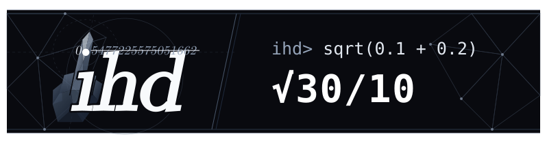

# i-hate-decimal-calc / ihd

<p align="center">
  
</p>

小数を一切許さず、すべての入力を即座に分数化し、平方根や定数をシンボルのまま厳密計算する電卓CLIツール / A strict CAS calculator CLI that completely rejects decimal approximations, converting all decimals to exact fractions and maintaining exact algebraic forms.


[](https://github.com/DovahkiinYuzuko/i-hate-decimal-calc/actions/workflows/lean-verify.yml)
[](https://github.com/DovahkiinYuzuko/i-hate-decimal-calc/actions/workflows/typst-verify.yml)
[](./LICENSE.MIT)

[日本語](#日本語) | [English](#english)

---

## 日本語

### なぜ ihd なのか？（小数の排除と厳密代数計算）

一般的なプログラミング言語や関数電卓では、小数を扱う際に `float64` などの浮動小数点数を使用するため、不可避の丸め誤差が生じます。また、無理数や超越数も適当な桁数で丸められてしまいます。

`ihd`（i-hate-decimal-calc）は、**「小数の存在を一切許さない」** という思想のもと設計された、コマンドライン向けの厳密数式処理システム（CAS）電卓です。入力された小数は字句解析の段階で即座に任意精度有理数（`big.Rat`）へ変換され、平方根・三角関数・対数・超越数・虚数単位はシンボルノードとして保持され、代数的簡約ルールによって厳密な形式のまま計算されます。

| 入力数式              | 一般的な電卓・言語（浮動小数点数） | `ihd`（厳密計算） | 簡約・処理内容                               |
| :-------------------- | :--------------------------------- | :---------------- | :------------------------------------------- |
| `0.1 + 0.2`           | `0.30000000000000004`              | `3/10`            | 誤差ゼロの有理数約分                         |
| `0.(3)`               | `0.3333333333333333`               | `1/3`                 | 循環小数をFSM字句解析により厳密分数化        |
| `sqrt(8)`             | `2.8284271247461903`               | `2*√2`                | 平方因子の自動くくり出し                     |
| `sqrt(5 + 2*sqrt(6))` | `3.1462643699419726`               | `√2 + √3`             | Borodin (1985) 法による二重根号の自動分解    |
| `1 / (sqrt(2) + 1)`   | `0.4142135623730951`               | `-1 + √2`             | 2項無理数分母の共役有理化                    |
| `sin(pi/6)`           | `0.49999999999999994`              | `1/2`                 | 特殊角の代数的厳密値評価                     |
| `１＋２×３`           | エラー（全角未対応）               | `7`                   | 日本語IMEの全角文字を透過的に半角ASCII正規化 |

> [!WARNING]
> **計算結果の正確性と外部検証について（重要な注意事項）**:  
> `ihd` は「小数の排除と厳密代数計算」を追求していますが、すべての数式処理において完全無欠・100%の正しさを保証するものではありません。複雑な不定積分、代数方程式、極限計算などにおいて、簡約アルゴリズムの未成熟さや実装上の制限により、計算結果を誤ったり一部の解が欠落したりする場合があります。  
> 現在本リポジトリでは、GitHub Actions CI 上で**単体テスト（`unit-test.yml`）**、**Lean 4 カーネル形式証明（`lean-verify.yml`）**、**Typst 数式コンパイル（`typst-verify.yml`）**、および**数学的不変条件ファジング（`fuzz-smoke.yml`）** を常時実行しており、CI テストスイートに含まれる範囲については機械的に検証・保証されています。しかし、それを超える任意の入力については計算誤りが生じる可能性を排除できません。  
> そのため、`ihd` では計算結果を鵜呑みにせず外部から客観的に第三者検証できるよう、**逆算検算（`--verify`）**、**計算証明書の発行（`--certificate`）**、**独立マイクロ検証器（`tools/micro-verifier`）**、および**定理証明系 Lean 4 連携（`--lean`）** などの検証基盤を積極的に整備・開発し続けています。学術研究や業務などの重要な計算に際しては、必ず自己検算や外部検証ツールとの併用をお願いいたします。

<details>
<summary><b>ロゴの小話</b></summary>

- **小数点へのアンチテーゼ**: トップバナーの `ihd` の `i` の上のドットは、`sqrt(0.1 + 0.2)` の真の値 `0.54772255750516611345...`（無限に続く無理数）が小数第16位で打ち切られ末尾が `...1661` から `...1662` へと丸め込まれた近似小数値 `0.5477225575051662` の小数点 `.` と座標（`cx=125.2, cy=76.8`）を共有しており、背面レイヤーの多面体（ローポリゴン）の中指によって下から突き上げられ打ち消されています。その対比として、右側には `ihd` による有理化・平方因子抽出済みの厳密解 `√30/10` が配置されています。
- **`ihd` 自身によるレイアウト余白の連立方程式求解**: バナー内の左タイポグラフィ（実測幅 `164px`）と右REPL出力（実測幅 `302px`）について、左右の外枠（左端 `x=10`）からの外側余白および中央の斜め分割線からの内側余白が完全に対称となる4つのX座標 $[L_{\min}, X_{\text{div}}, R_{\min}, X_{\text{right}}]$ は、`ihd` 自身の連立一次方程式ソルバ `linsolve` を用いて算出・配置されています。
  ```text
  ihd> linsolve([[1, 0, 1, -1], [1, -2, 1, 0], [1, 0, 0, 0], [0, 1, 0, 0]], [-292, -164, 100, 330])
  [100, 330, 396, 788]
  ```
</details>

---

### インストール

#### ワンライナーインストール（推奨）

**Linux / macOS (bash / zsh):**
```bash
curl -fsSL https://raw.githubusercontent.com/DovahkiinYuzuko/i-hate-decimal-calc/main/install.sh | bash
```

**Windows (PowerShell):**
```powershell
irm https://raw.githubusercontent.com/DovahkiinYuzuko/i-hate-decimal-calc/main/install.ps1 | iex
```

> [!NOTE]
> **Android (Termux) やログインシェル環境でのご利用について**:  
> Termux などの環境では、起動時に `~/.bashrc` ではなく `~/.bash_profile` が優先評価されます。PATH 設定を永続化するには、`~/.bash_profile` に `export PATH="$HOME/.ihd/bin:$PATH"` を追記するか、`~/.bash_profile` 内で `~/.bashrc` を読み込む（`[ -f ~/.bashrc ] && . ~/.bashrc`）ように設定してください。

#### ソースコードからのビルド

Go 1.26.5 がインストールされている環境で、リポジトリルートにてビルドします：

```bash
go build -o ihd ./cmd/ihd
```

---

### クイックスタート & 実行形態

#### 1. ワンショット計算（CLI引数）
コマンドライン引数に数式を渡すだけで即座に厳密計算を実行します。

```bash
# 基本有理数演算
ihd "1/2 + 1/3"
# 出力: 5/6

# 平方根の自動簡約と無理数同値性判定
ihd "sqrt(2) + sqrt(3) == sqrt(5 + 2*sqrt(6))"
# 出力: true

# 実代数不等式の厳密解（CAD / Sturm根分離）
ihd "solve(x^2 - 4 < 0)"
# 出力: [[-2, 2]]
```

#### 2. 対話モード（REPL）
引数なしで起動すると、履歴機能・カーソル移動・日本語IME対応を備えた対話型REPLが起動します。

```text
$ ihd
ihd: Exact Arithmetic Calculator
Type 'exit' or 'quit' to exit.
ihd> 1/2 + 1/3
5/6
ihd> ans * 6
5
ihd> x = 1 + sqrt(2)
1 + √2
ihd> exit
Goodbye.
```

#### 3. 標準入力パイプ（バッチ連携）
他コマンドからのパイプ入力を処理できます。同一セッション内では変数が引き継がれます。

```bash
echo "sin(pi/6)^2 + cos(pi/6)^2" | ihd
# 出力: 1

printf "x = 1/2 + sqrt(2)\nx * 2\n" | ihd
# 出力:
# 1/2 + √2
# 1 + 2*√2
```

#### 4. スクリプトファイルの実行（`ihd run <file.ihd>`）
複数行の数式や変数定義を記述した `.ihd` スクリプトを一括実行できます。末尾にセミコロン `;` を付与した行は評価を行いながら結果出力を抑制します。

```bash
ihd run sample.ihd
# または直接指定
ihd sample.ihd
```

#### 5. 日本語IMEの全角自動正規化
日本語IMEがONのまま入力された全角文字（数字、英字、`＋` `−` `×` `÷` `＾` `！` `＝`、全角括弧、全角スペース等）は自動的に半角ASCIIへ透過変換されます。

```bash
ihd "１＋２×３"
# 出力: 7
```

---

### 主な機能

`ihd` は数式処理エンジンの正確さに加え、ターミナルでの視覚的・対話的な使いやすさを追求しています。

- **途中式ツリー & 形式証明射影 (`--explain`)**: 有理化、二重根号外し、因数分解、極限（ロピタル）などの適用過程を2Dツリーで可視化します。さらに単一の導出ツリーから **Typst ドキュメント (`--typst`)** や **Lean 4 等式連鎖証明 (`--lean`)** へ直接射影できます。
- **ターミナル2D数式組版 (`--pretty`)**: 分数線や根号を複数行アスキーアートボックスモデルで描画します。
- **Braille 2×4 点字高解像度プロッタ (`plot`)**: 点字文字を用いたサブピクセル描画により、端末上に関数の形状や極値・零点をプロットします。
- **REPL リアルタイム引数ガイド & 構文ハイライト**: 外部依存ゼロの有限状態機械（FSM）により、入力中の引数案内、多言語シグネチャヘルパー、ネスト深度別レインボー括弧、セッション変数ハイライトを提供します。
- **厳密有理数ベクトル空間による物理単位計算**: 有理数体 $\mathbb{Q}$ 上の 7 次元ベクトル空間（SI基本単位）に基づき、小数を一切排除した単位乗除算、組立単位展開、次元解析、単位換算（`convert_unit`）を実行します。
- **コレクション操作 & ラムダ式**: Python スタイルのスライス構文（`[start:end:step]`）、数列生成 `range`、第一級無名関数 `lambda`、高階関数 `map`, `filter` をサポートしています。
- **ループ暴走ガード (`--warn-loop` / `--max-loop`)**: CAS反復構文（`table`, `for`, `product`）において、警告閾値超過時にパイプラインを汚さず `os.Stderr` へ非破壊警告を発出し、上限到達時は強制遮断します。

> [!TIP]
> ターミナル組版のアスキーアート、点字グラフ描画、途中式ツリー、Typst/Lean4出力コードなどの詳細な出力見本は **[出力サンプル集 (sample/sample.ja.md)](./sample/sample.ja.md)** をご覧ください。

---

### 構文・演算子・関数リファレンス

`ihd` は大学理工系レベルを網羅する 50 種類以上の厳密代数関数を搭載しています。

- **基本代数・数論・方程式**: `expand`, `factor`, `apart`, `together`, `gcd`, `lcm`, `mod`, `is_prime`, `solve`, `cfrac`, `groebner`, `sturm` など
- **三角関数・対数・複素数**: `sin`, `cos`, `tan`, `asin`, `acos`, `atan`, `trig_expand`, `trig_reduce`, `exp`, `log`, `ln`, `polar` など
- **微積分・常微分方程式・特殊関数**: `diff`, `integrate`, `limit`, `taylor`, `dsolve`, `laplace`, `lambert_w`, `erf`, `gamma`, `sum` など
- **線形代数・線形計画・整数標準形**: `det`, `inv`, `rank`, `rref`, `eigenvals`, `linsolve`, `lp_maximize`, `hnf`, `snf`, `lll` など
- **幾何学解析・自動証明**: `line_intersect`, `circle_intersect`, `triangle_area`, `geo_prove`（呉の方法）など
- **代数構造・数論幾何・量子**: `galois_group`, `is_solvable_by_radicals`, `ec_p_order`, `ec_rank_bound`, `clifford`, `quantum_equiv` など
- **物理単位・仮定・反復**: `convert_unit`, `assume`, `unassume`, `table`, `range`, `map`, `filter` など

> [!TIP]
> 各関数の詳細な仕様、引数定義、数学的解説、および使用例は専用リファレンスを参照してください。  
> - **Markdown版**: [日本語版 (docs/references/ja/reference.ja.md)](docs/references/ja/reference.ja.md) / [英語版 (docs/references/en/reference.en.md)](docs/references/en/reference.en.md)  
> - **オフラインSingle-File HTML版**: [日本語版 (docs/references/ja/reference.ja.html)](docs/references/ja/reference.ja.html) / [英語版 (docs/references/en/reference.en.html)](docs/references/en/reference.en.html)

---

### コマンドラインオプション & サブコマンド

#### サブコマンド

| コマンド | 説明・使用例 |
| :--- | :--- |
| `ihd diff <f1\|e1> <f2\|e2>` | 2つの数式またはスクリプトを比較し、展開・因数分解による代数的同値性（`EQUIVALENT`）や相違（`CHANGED`）を判定する意味論的差分。<br>`ihd diff "x^2 - 1" "(x - 1)*(x + 1)"` |
| `ihd run <file.ihd>` | 複数行の数式や変数定義を記述したスクリプトを一括実行。<br>`ihd run script.ihd` |
| `ihd completion <shell>` | 主要シェル（`bash`, `zsh`, `fish`, `powershell`）向けの自動補完スクリプトを生成。<br>`ihd completion powershell \| Out-String \| Invoke-Expression` |
| `ihd update` | 最新リリースへの自己アップデートを実行（`self-update` も可）。 |

#### 主なCLIオプション

| オプション | 説明・使用例 |
| :--- | :--- |
| `--explain` | 計算過程（有理化・因数分解・微分則・極限等）を途中式ツリーとして表示。<br>`ihd --explain "1 / (sqrt(2) + 1)"` |
| `--pretty` | 分数線や根号を複数行アスキーアートで組版表示する2Dプリティプリント。<br>`ihd --pretty "1/2 + sqrt(2)/2"` |
| `--format <fmt>` | 出力フォーマットを指定（`typst`, `latex`, `ascii`, `pretty`）。<br>`ihd --format typst "1/2 + sqrt(2)"` |
| `--typst` | 組版システム Typst の数式記法（`$ ... $`）で出力。<br>`ihd --typst "1/2 + sqrt(2)"` |
| `--latex` | LaTeX 形式（`$$ ... $$`）で数式を出力。<br>`ihd --latex "1/2 + sqrt(2)"` |
| `--ascii` | 数学記号（`√`, `π`）をASCII文字列（`sqrt`, `pi`）にフォールバック。<br>`ihd --ascii "sqrt(2) + pi"` |
| `--approx` | 厳密解の横に参考用の浮動小数点小数近似値（float64）を併記。<br>`ihd --approx "sqrt(2)"` |
| `--verify` | 計算結果に対し、定義式や導関数に基づく逆算検算を実行。<br>`ihd --verify "integrate(1/(x^2 + 1), x)"` |
| `--certificate [file]` | 計算結果と導出ステップ列を証明書 JSON（`ihd-proof-trace-v1`）として出力または保存。<br>`ihd --certificate cert.json "factor(x^2 - 1)"` |
| `--replay <file>` | 保存された証明書 JSON ファイルを読み込み、各ステップの残差が0かを再検証。<br>`ihd --replay cert.json` |
| `--lean` | 定理証明支援系 **Lean 4（Mathlib4）** の形式証明コードを出力。<br>`ihd --lean "factor(x^2 - 1)"` |
| `--lean-file <path>` | 生成された Lean 4 証明コードをスタンドアロンな `.lean` ファイルとして保存。<br>`ihd --lean-file proof.lean "factor(x^2 - 1)"` |
| `-i`, `--interval` | 適応的区間細分化（Rational Interval Arithmetic）による包含区間を算出。<br>`ihd -i "sin(1)"` |
| `--deg` | 三角関数および逆三角関数を度数法（Degree）として解釈・計算。<br>`ihd --deg "sin(30)"` |
| `--theme <dark\|light\|none>` | REPLのカラーテーマを指定（`~/.ihd/config.json` に永続化）。<br>`ihd --theme light` |
| `--lang <code/auto>` | 表示言語を指定（`ja`, `en`, `auto`）。<br>`ihd --lang en "1/2 + 1/3"` |
| `--timeout <dur>` | 壁時計時間タイムアウトを指定（例: `2s`, `500ms`）。<br>`ihd --timeout 2s "factor(x^100 - 1)"` |
| `--deterministic` | マップ反復や多項式順序を正規化し、バイト単位で決定論的な出力を保証。<br>`ihd --deterministic "factor(x^4 - 5*x^2 + 4)"` |
| `-h`, `--help` | 利用可能な全オプションと詳細なヘルプを表示。 |

> [!NOTE]
> すべてのコマンドラインフラグ一覧と詳細仕様は `ihd --help` を実行して確認してください。

---

### 開発とテスト

リポジトリをクローンした開発者環境において、以下の標準コマンドでテストおよび検証を実行できます。

#### 1. 単体テスト
全パッケージの Go 単体テストを実行します。
```bash
go test ./...
```

#### 2. 数学的不変条件 Property-Based Testing & Fuzzing
ガウス有理数体 $\mathbb{Q}[i]$ 上の厳密多点評価オラクル（Schwartz-Zippel補題）を用いたファジングハーネスを実行します。
```bash
# 全シードコーパスおよびオラクル単体テストのスモーク実行
go test -v ./internal/calc -run "^(Fuzz|TestOracle|TestProvider)"

# 特定ターゲットに対する連続ファジング探索（例: 30秒間）
go test ./internal/calc -run "^FuzzAlgebra_SimplifyIdempotence$" -fuzz "^FuzzAlgebra_SimplifyIdempotence$" -fuzztime 30s
```

#### 3. 独立証明検証器（`tools/micro-verifier`）
本体ソルバロジックに依存せず、発行された証明書 JSON を独立して第三者検証するスタンドアロンCLIツールです。
```bash
# 独立検証器の単体テスト
go test ./tools/micro-verifier

# 証明書ファイルの独立検証
go run ./tools/micro-verifier cert.json
```

#### 4. 実演ショウケース（Exam）
高校数学から数学オリンピック・理工系大学数学までの代表24問を自動で解き進める実演デモです。
```bash
# Windows (PowerShell)
pwsh exam/exam.ps1

# Linux / macOS (Bash)
./exam/exam.sh
```

---

### 実践レシピ集（Exam & Cookbook）

24問の代表的な数学問題（数I・A・II・B・III・C、難関大入試、線形代数、微積分、数論、幾何）に対する `ihd` を用いた解法と解説レシピ集です。
- [日本語版レシピ集 (exam/problems.ja.md)](./exam/problems.ja.md)
- [英語版レシピ集 (exam/problems.en.md)](./exam/problems.en.md)

---

### LICENSE

[MIT](./LICENSE.MIT)

Third-Party → [NOTICE.md](./NOTICE.md)

---

## English

### Why ihd? (Elimination of Decimals & Exact Algebraic Computation)

Standard programming languages and calculators rely on `float64` floating-point numbers, inevitably introducing rounding errors and truncating irrational or transcendental values into finite decimals.

`ihd` (i-hate-decimal-calc) is a command-line Computer Algebra System (CAS) calculator built on the strict philosophy of **"Never tolerate decimals."** All decimal inputs are converted into exact arbitrary-precision rational fractions (`big.Rat`) during lexical analysis. Radicals, trigonometric functions, logarithms, transcendental constants, and imaginary units are preserved as symbolic AST nodes and simplified using rigorous algebraic rewrite rules.

| Input Expression      | Typical Calculators / Languages (`float64`) | `ihd` (Exact Calculation) | Simplification Behavior                                             |
| :-------------------- | :------------------------------------------ | :------------------------ | :------------------------------------------------------------------ |
| `0.1 + 0.2`           | `0.30000000000000004`                       | `3/10`                    | Zero-error exact rational fraction                                  |
| `0.(3)`               | `0.3333333333333333`                        | `1/3`                     | FSM lexical analysis converts repeating decimals to exact fractions |
| `sqrt(8)`             | `2.8284271247461903`                        | `2*√2`                    | Automatic extraction of perfect squares                             |
| `sqrt(5 + 2*sqrt(6))` | `3.1462643699419726`                        | `√2 + √3`                 | Automatic radical denesting via Borodin (1985) algorithm            |
| `1 / (sqrt(2) + 1)`   | `0.4142135623730951`                        | `-1 + √2`                 | Binomial conjugate radical rationalization                          |
| `sin(pi/6)`           | `0.49999999999999994`                       | `1/2`                     | Exact algebraic evaluation of special angles                        |
| `１＋２×３`           | Error (Unsupported)                         | `7`                       | Automatic normalization of Zenkaku characters to ASCII              |

> [!WARNING]
> **Mathematical Exactness & External Verification (Important Notice)**:  
> While `ihd` strictly rejects decimal approximations and maintains exact symbolic representations, it does **not** guarantee 100% mathematical flawlessness across all mathematical domains. Due to the inherent algorithmic complexities of Computer Algebra Systems (CAS) and active ongoing development, `ihd` may occasionally produce incorrect, incomplete, or partially reduced results—particularly in advanced integration, limits, or equation solving.  
> Currently, this repository continuously runs automated pipelines in GitHub Actions CI for **Unit Tests (`unit-test.yml`)**, **Lean 4 Kernel Formal Verification (`lean-verify.yml`)**, **Typst Math Compilation (`typst-verify.yml`)**, and **Mathematical Invariants Fuzzing (`fuzz-smoke.yml`)**. Expressions and theorems included within the CI test suite are mechanically verified and guaranteed. However, calculations outside of these explicit suites may be subject to bugs or omissions.  
> To address this, `ihd` prioritizes **external verifiability** over blind trust. We actively develop verifiable pipelines including **automated reverse-verification (`--verify`)**, **proof certificates (`--certificate`)**, a **standalone micro-verifier (`tools/micro-verifier`)**, and formal theorem transpilation to **Lean 4 (`--lean`)**. For critical research or mission-critical calculations, always independently verify results with external tools.

<details>
<summary><b>Logo Trivia</b></summary>

- **Defying the Decimal Point**: In the top banner, the dot of the `i` in `ihd` shares the exact coordinates (`cx=125.2, cy=76.8`) with the decimal point `.` of `0.5477225575051662`—where the infinite irrational expansion `0.54772255750516611345...` of `sqrt(0.1 + 0.2)` is truncated at the 16th decimal place and rounded from `...1661` to `...1662`—and is struck out from below by a low-poly middle finger in the background layer. In stark contrast, the right side displays `ihd`'s exact rationalized result, `√30/10`.
- **Layout Coordinates Solved by `ihd` Itself**: Given the rendered bounding-box widths of the left typography (`164px`) and the right REPL output (`302px`), the four horizontal coordinates $[L_{\min}, X_{\text{div}}, R_{\min}, X_{\text{right}}]$ that equalize both the outer frame margins (from left border `x=10`) and the inner margins around the central diagonal divider were computed directly using `ihd`'s own linear system solver `linsolve`:
  ```text
  ihd> linsolve([[1, 0, 1, -1], [1, -2, 1, 0], [1, 0, 0, 0], [0, 1, 0, 0]], [-292, -164, 100, 330])
  [100, 330, 396, 788]
  ```
</details>

---

### Installation

#### One-line Installer (Recommended)

**Linux / macOS (bash / zsh):**
```bash
curl -fsSL https://raw.githubusercontent.com/DovahkiinYuzuko/i-hate-decimal-calc/main/install.sh | bash
```

**Windows (PowerShell):**
```powershell
irm https://raw.githubusercontent.com/DovahkiinYuzuko/i-hate-decimal-calc/main/install.ps1 | iex
```

> [!NOTE]
> **Android (Termux) & Login Shell Environments**:  
> In environments like Termux on Android, `~/.bash_profile` is evaluated primarily upon session startup instead of `~/.bashrc`. To persist the `PATH` environment variable across sessions, append `export PATH="$HOME/.ihd/bin:$PATH"` to your `~/.bash_profile`, or ensure `~/.bashrc` is sourced within `~/.bash_profile` (`[ -f ~/.bashrc ] && . ~/.bashrc`).

#### Building from Source

Requires Go 1.26.5. Build directly from the root of the repository:

```bash
go build -o ihd ./cmd/ihd
```

---

### Quick Start & Execution Modes

#### 1. One-shot Calculation
Provide expressions directly as command-line arguments for instant exact evaluation:

```bash
# Exact rational arithmetic
ihd "1/2 + 1/3"
# Output: 5/6

# Exact algebraic equivalence & nested radicals
ihd "sqrt(2) + sqrt(3) == sqrt(5 + 2*sqrt(6))"
# Output: true

# Real algebraic inequality solving (CAD / Sturm root isolation)
ihd "solve(x^2 - 4 < 0)"
# Output: [[-2, 2]]
```

#### 2. Interactive REPL
Running without arguments launches the interactive REPL with command history, navigation, and full IME support:

```text
$ ihd
ihd: Exact Arithmetic Calculator
Type 'exit' or 'quit' to exit.
ihd> 1/2 + 1/3
5/6
ihd> ans * 6
5
ihd> x = 1 + sqrt(2)
1 + √2
ihd> exit
Goodbye.
```

#### 3. Piped Input (Batch Integration)
Process expressions sequentially from standard input. Variable states persist across lines within the same piped session:

```bash
echo "sin(pi/6)^2 + cos(pi/6)^2" | ihd
# Output: 1

printf "x = 1/2 + sqrt(2)\nx * 2\n" | ihd
# Output:
# 1/2 + √2
# 1 + 2*√2
```

#### 4. Script Execution (`ihd run <file.ihd>`)
Execute `.ihd` text files containing multi-line variable definitions and calculations. Lines ending with a semicolon `;` suppress output display while still persisting variables:

```bash
ihd run sample.ihd
# Or direct invocation
ihd sample.ihd
```

#### 5. Full-width (Zenkaku) Normalization
Automatically normalizes full-width digits, letters, operators (`＋`, `−`, `×`, `÷`, `＾`, `！`, `＝`), parentheses, and spaces to half-width ASCII across all execution modes:

```bash
ihd "１＋２×３"
# Output: 7
```

---

### Feature Highlights

`ihd` balances rigorous mathematical exactness with terminal productivity and visual clarity:

- **Derivation Step Trees & Formal Proofs (`--explain`)**: Visualizes exact transformation steps across rationalization, radical denesting, factoring, and limits (L'Hopital). From a single provenance DAG, it directly projects into **Typst documents (`--typst`)** or **Lean 4 transitive equational proofs (`--lean`)**.
- **Terminal 2D Pretty Printing (`--pretty`)**: Renders fractions, square roots, and matrices in multi-line ASCII/Unicode box-model typography.
- **Braille 2×4 Subpixel Terminal Plotter (`plot`)**: Uses Unicode Braille characters to plot function curves, extrema, and roots directly in terminal windows.
- **REPL Real-time Signature Guide & Syntax Highlighting**: Zero-dependency FSM provides real-time argument index indicators, localized signature tooltips, rainbow nested parentheses, and session variable highlighting.
- **Exact Rational Physical Units & Dimensional Analysis**: Implements exact dimensional calculus over the 7-dimensional vector space $\mathbb{Q}^7$ of SI base units, supporting unit multiplication, prefix scaling, and exact conversions (`convert_unit`).
- **Collection Manipulation & Lambdas**: Supports Python-style slicing (`[start:end:step]`), rational range sequences (`range`), first-class lambdas, and higher-order functions (`map`, `filter`).
- **Iteration Runaway Guard (`--warn-loop` / `--max-loop`)**: Protects against runaway CAS loops (`table`, `for`, `product`) with non-destructive `stderr` warnings and hard cutoffs.

> [!TIP]
> For detailed visual examples, ASCII plots, derivation trees, and Typst/Lean4 outputs, see the **[Visual Samples & Showcases (sample/sample.en.md)](./sample/sample.en.md)**.

---

### Syntax & Functions Reference

`ihd` is equipped with over 50 exact symbolic functions covering university-level STEM domains:

- **Basic Algebra, Number Theory & Equations**: `expand`, `factor`, `apart`, `together`, `gcd`, `lcm`, `mod`, `is_prime`, `solve`, `cfrac`, `groebner`, `sturm`, etc.
- **Trigonometric, Logarithmic & Complex Functions**: `sin`, `cos`, `tan`, `asin`, `acos`, `atan`, `trig_expand`, `trig_reduce`, `exp`, `log`, `ln`, `polar`, etc.
- **Calculus, ODEs & Special Functions**: `diff`, `integrate`, `limit`, `taylor`, `dsolve`, `laplace`, `lambert_w`, `erf`, `gamma`, `sum`, etc.
- **Linear Algebra, Linear Programming & Normal Forms**: `det`, `inv`, `rank`, `rref`, `eigenvals`, `linsolve`, `lp_maximize`, `hnf`, `snf`, `lll`, etc.
- **Computational Geometry & Automated Proving**: `line_intersect`, `circle_intersect`, `triangle_area`, `geo_prove` (Wu's method), etc.
- **Algebraic Structures, Arithmetic Geometry & Quantum**: `galois_group`, `is_solvable_by_radicals`, `ec_p_order`, `ec_rank_bound`, `clifford`, `quantum_equiv`, etc.
- **Units, Assumptions & CAS Iteration**: `convert_unit`, `assume`, `unassume`, `table`, `range`, `map`, `filter`, etc.

> [!TIP]
> For complete specifications, parameter definitions, mathematical explanations, and examples:  
> - **Markdown Edition**: [Japanese (docs/references/ja/reference.ja.md)](docs/references/ja/reference.ja.md) / [English (docs/references/en/reference.en.md)](docs/references/en/reference.en.md)  
> - **Offline Single-File HTML Edition**: [Japanese (docs/references/ja/reference.ja.html)](docs/references/ja/reference.ja.html) / [English (docs/references/en/reference.en.html)](docs/references/en/reference.en.html)

---

### Command-Line Options & Subcommands

#### Subcommands

| Command | Description & Examples |
| :--- | :--- |
| `ihd diff <f1\|e1> <f2\|e2>` | Compares two expressions or scripts to determine algebraic equivalence (`EQUIVALENT`) or changes (`CHANGED`).<br>`ihd diff "x^2 - 1" "(x - 1)*(x + 1)"` |
| `ihd run <file.ihd>` | Executes multi-line variable definitions and expressions from a script file.<br>`ihd run script.ihd` |
| `ihd completion <shell>` | Generates tab completion scripts for major shells (`bash`, `zsh`, `fish`, `powershell`).<br>`ihd completion powershell \| Out-String \| Invoke-Expression` |
| `ihd update` | Self-updates the binary to the latest GitHub release (`self-update` also accepted). |

#### Major CLI Options

| Option | Description & Examples |
| :--- | :--- |
| `--explain` | Displays step-by-step algebraic derivation trees.<br>`ihd --explain "1 / (sqrt(2) + 1)"` |
| `--pretty` | Output expression in multi-line 2D pretty-printed Unicode typography.<br>`ihd --pretty "1/2 + sqrt(2)/2"` |
| `--format <fmt>` | Specify output format (`typst`, `latex`, `ascii`, `pretty`).<br>`ihd --format typst "1/2 + sqrt(2)"` |
| `--typst` | Output expression in Typst math mode format (`$ ... $`).<br>`ihd --typst "1/2 + sqrt(2)"` |
| `--latex` | Output expression in LaTeX format (`$$ ... $$`).<br>`ihd --latex "1/2 + sqrt(2)"` |
| `--ascii` | Output using standard ASCII strings (`sqrt`, `pi`) instead of Unicode symbols.<br>`ihd --ascii "sqrt(2) + pi"` |
| `--approx` | Display approximate floating-point decimal value alongside the exact form.<br>`ihd --approx "sqrt(2)"` |
| `--verify` | Reverse-verifies algebraic correctness by checking residual vanishing.<br>`ihd --verify "integrate(1/(x^2 + 1), x)"` |
| `--certificate [file]` | Exports calculation steps and residuals into a certificate JSON file.<br>`ihd --certificate cert.json "factor(x^2 - 1)"` |
| `--replay <file>` | Reads a certificate JSON file and verifies that residuals vanish.<br>`ihd --replay cert.json` |
| `--lean` | Transpiles calculation results into formal **Lean 4 (Mathlib4)** proof theorems.<br>`ihd --lean "factor(x^2 - 1)"` |
| `--lean-file <path>` | Save generated Lean 4 proof code as a standalone `.lean` file.<br>`ihd --lean-file proof.lean "factor(x^2 - 1)"` |
| `-i`, `--interval` | Evaluates expressions using adaptive rational interval arithmetic enclosures.<br>`ihd -i "sin(1)"` |
| `--deg` | Evaluate trigonometric functions in degrees.<br>`ihd --deg "sin(30)"` |
| `--theme <dark\|light\|none>` | Specify REPL color theme (persisted to `~/.ihd/config.json`).<br>`ihd --theme light` |
| `--lang <code/auto>` | Specify display language (`ja`, `en`, `auto`).<br>`ihd --lang en "1/2 + 1/3"` |
| `--timeout <dur>` | Sets wall-clock execution timeout (e.g. `2s`, `500ms`).<br>`ihd --timeout 2s "factor(x^100 - 1)"` |
| `--deterministic` | Normalizes iterations and polynomial ordering for byte-identical outputs.<br>`ihd --deterministic "factor(x^4 - 5*x^2 + 4)"` |
| `-h`, `--help` | Display full options list and command help message. |

> [!NOTE]
> For the complete list of flags and options, run `ihd --help`.

---

### Development & Testing

Developers who clone this repository can run tests and verifications using the following standard commands:

#### 1. Unit Tests
Runs standard Go unit tests across all packages:
```bash
go test ./...
```

#### 2. Mathematical Invariants Property-Based Testing & Fuzzing
Executes the fuzzing harness with exact multi-point evaluation oracles over Gaussian rationals $\mathbb{Q}[i]$:
```bash
# Smoke test all seed corpora and oracle tests
go test -v ./internal/calc -run "^(Fuzz|TestOracle|TestProvider)"

# Continuous fuzzing exploration on a specific invariant target (e.g., 30s)
go test ./internal/calc -run "^FuzzAlgebra_SimplifyIdempotence$" -fuzz "^FuzzAlgebra_SimplifyIdempotence$" -fuzztime 30s
```

#### 3. Standalone Proof Verifier (`tools/micro-verifier`)
A standalone CLI tool that independently verifies emitted certificate JSON files without relying on `ihd` solver logic:
```bash
# Unit tests for verifier
go test ./tools/micro-verifier

# Standalone verification of certificate file
go run ./tools/micro-verifier cert.json
```

#### 4. Live Exam Showcase
An automated showcase solving 24 benchmark problems ranging from high school math to competitions and university STEM:
```bash
# Windows (PowerShell)
pwsh exam/exam.ps1

# Linux / macOS (Bash)
./exam/exam.sh
```

---

### Practical Problem Cookbook (Exam & Cookbook)

Practical cookbook recipes and explanations solving 24 benchmark problems using `ihd`:
- [Japanese Edition Cookbook (exam/problems.ja.md)](./exam/problems.ja.md)
- [English Edition Cookbook (exam/problems.en.md)](./exam/problems.en.md)

---

### LICENSE

[MIT](./LICENSE.MIT)

Third-Party → [NOTICE.md](./NOTICE.md)
