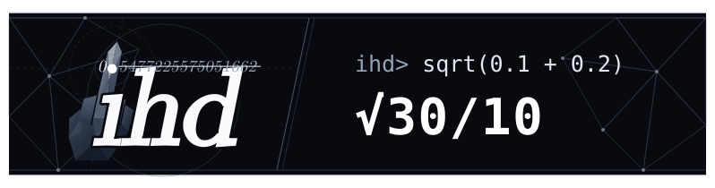

# i-hate-decimal-calc / ihd

<p align="center">
  
</p>

小数を一切許さず、すべての入力を即座に任意精度有理数（`big.Rat`）へ変換し、平方根・定数・p進数・ピュイズー級数・有理区間をシンボルのまま厳密計算するコマンドライン数式処理（CAS）電卓です。


[](https://github.com/DovahkiinYuzuko/i-hate-decimal-calc/actions/workflows/lean-verify.yml)
[](https://github.com/DovahkiinYuzuko/i-hate-decimal-calc/actions/workflows/typst-verify.yml)
[](./LICENSE.MIT)

[日本語](README.md) | [English](README.en.md)

## 目次

- [なぜ ihd なのか？（小数の排除と厳密代数計算）](#なぜ-ihd-なのか小数の排除と厳密代数計算)
- [インストール](#インストール)
- [クイックスタート & 実行形態](#クイックスタート--実行形態)
- [主な機能](#主な機能)
- [構文・演算子・関数リファレンス](#構文演算子関数リファレンス)
- [コマンドラインオプション & サブコマンド](#コマンドラインオプション--サブコマンド)
- [開発とテスト](#開発とテスト)
- [実践レシピ集（Exam & Cookbook）](#実践レシピ集exam--cookbook)
- [LICENSE](#license)

### なぜ ihd なのか？（小数の排除と厳密代数計算）

一般的なプログラミング言語や関数電卓では、小数を扱う際に `float64` などの浮動小数点数を使用するため、丸め誤差が生じます。また、無理数や超越数も一定の有効桁数で打ち切られて近似値になります。

`ihd`（i-hate-decimal-calc）は、**「小数の存在を一切許さない」** という思想のもと設計された、コマンドライン向けの厳密数式処理システム（CAS）電卓です。入力された小数は字句解析の段階で即座に任意精度有理数（`big.Rat`）へ変換され、平方根・三角関数・対数・超越数・虚数単位・p進展開・ピュイズー級数・有理閉区間は第一級シンボルノードとして保持され、代数的簡約ルールによって厳密な形式のまま計算されます。

| 入力数式              | 一般的な電卓・言語（浮動小数点数） | `ihd`（厳密計算） | 簡約・処理内容                               |
| :-------------------- | :--------------------------------- | :---------------- | :------------------------------------------- |
| `0.1 + 0.2`           | `0.30000000000000004`              | `3/10`            | 誤差ゼロの有理数約分                         |
| `0.(3)`               | `0.3333333333333333`               | `1/3`             | 循環小数をFSM字句解析により厳密分数化        |
| `sqrt(8)`             | `2.8284271247461903`               | `2*√2`            | 平方因子の自動くくり出し                     |
| `sqrt(5 + 2*sqrt(6))` | `3.1462643699419726`               | `√2 + √3`         | Borodin (1985) 法による二重根号の自動分解    |
| `1 / (sqrt(2) + 1)`   | `0.4142135623730951`               | `-1 + √2`         | 2項無理数分母の共役有理化                    |
| `sin(pi/6)`           | `0.49999999999999994`              | `1/2`             | 特殊角の代数的厳密値評価                     |
| `１＋２×３`           | エラー（全角未対応）               | `7`               | 日本語IMEの全角文字を透過的に半角ASCII正規化 |

> [!WARNING]
> **計算結果の正確性と外部検証について（重要な注意事項）**:  
> `ihd` は「小数の排除と厳密代数計算」を追求していますが、すべての数式処理において完全無欠・100%の正しさを保証するものではありません。複雑な不定積分、代数方程式、極限計算などにおいて、簡約アルゴリズムの未成熟さや実装上の制限により、計算結果を誤ったり一部の解が欠落したりする場合があります。また、巨大合成数の素因数分解では決定論的な作業予算上限を設けており、予算超過時は発見済みの因子と未分解の合成数因子を残した部分分解を返却します。  
> 現在本リポジトリでは、GitHub Actions CI 上で**単体テスト（`unit-test.yml`）**、**Lean 4 カーネル形式証明（`lean-verify.yml`）**、**Typst 数式コンパイル（`typst-verify.yml`）**、および**数学的不変条件ファジング（`fuzz-smoke.yml`）** を常時実行しており、CI テストスイートに含まれる範囲については機械的に検証・保証されています。しかし、それを超える任意の入力については計算誤りが生じる可能性を排除できません。  
> そのため、`ihd` では計算結果を鵜呑みにせず外部から客観的に第三者検証できるよう、**逆算検算（`--verify`）**、**計算証明書の発行（`--certificate`）**、**独立マイクロ検証器（`tools/micro-verifier`）**、および**定理証明系 Lean 4 連携（`--lean`）** などの検証基盤を整備・開発しています。学術研究や業務などの重要な計算に際しては、必ず自己検算や外部検証ツールとの併用をお願いいたします。

<details>
<summary><b>ロゴの小話</b></summary>

- **小数点へのアンチテーゼ**: トップバナーの `ihd` の `i` の上のドットは、`sqrt(0.1 + 0.2)` の真の値 `0.54772255750516611345...`（無限に続く無理数）が小数第16位で打ち切られ末尾が `...1661` から `...1662` へと丸め込まれた近似小数値 `0.5477225575051662` の小数点 `.` と座標（`cx=125.2, cy=76.8`）を共有しており、背面レイヤーの多面体（ローポリゴン）の中指によって下から突き上げられ打ち消されています。その対比として、右側には `ihd` による有理化・平方因子抽出済みの厳密解 `√30/10` が配置されています。
- **`ihd` 自身によるレイアウト余白の連立方程式求解**: バナー内の左タイポグラフィ（実測幅 `164px`）と右REPL出力（実測幅 `302px`）について、左右の外枠（左端 `x=10`）からの外側余白および中央の斜め分割線からの内側余白が完全に対称となる4つのX座標 $[L_{\min}, X_{\text{div}}, R_{\min}, X_{\text{right}}]$ は、`ihd` 自身の連立一次方程式ソルバ `linsolve` を用いて算出・配置されています。
  ```text
  ihd> linsolve([[1, 0, 1, -1], [1, -2, 1, 0], [1, 0, 0, 0], [0, 1, 0, 0]], [-292, -164, 100, 330])
  [100, 330, 396, 788]
  ```
</details>

---

### インストール

#### ワンライナーインストール（推奨）

**Linux / macOS (bash / zsh):**
```bash
curl -fsSL https://raw.githubusercontent.com/DovahkiinYuzuko/i-hate-decimal-calc/main/install.sh | bash
```

**Windows (PowerShell):**
```powershell
irm https://raw.githubusercontent.com/DovahkiinYuzuko/i-hate-decimal-calc/main/install.ps1 | iex
```

> [!NOTE]
> **Android (Termux) やログインシェル環境でのご利用について**:  
> Termux などの環境では、起動時に `~/.bashrc` ではなく `~/.bash_profile` が優先評価されます。PATH 設定を永続化するには、`~/.bash_profile` に `export PATH="$HOME/.ihd/bin:$PATH"` を追記するか、`~/.bash_profile` 内で `~/.bashrc` を読み込む（`[ -f ~/.bashrc ] && . ~/.bashrc`）ように設定してください。

#### ソースコードからのビルド

Go 1.26.5 がインストールされている環境で、リポジトリルートにてビルドします：

```bash
go build -o ihd ./cmd/ihd
```

---

### クイックスタート & 実行形態

#### 1. ワンショット計算（CLI引数）
コマンドライン引数に数式を渡すだけで即座に厳密計算を実行します。

```bash
# 基本有理数演算
ihd "1/2 + 1/3"
# 出力: 5/6

# 平方根の自動簡約と無理数同値性判定
ihd "sqrt(2) + sqrt(3) == sqrt(5 + 2*sqrt(6))"
# 出力: true

# 実代数不等式の厳密解（CAD / Sturm根分離）
ihd "solve(x^2 - 4 < 0)"
# 出力: [[-2, 2]]
```

#### 2. 対話モード（REPL）
引数なしで起動すると、履歴機能・カーソル移動・日本語IME対応を備えた対話型REPLが起動します。

```text
$ ihd
ihd: Exact Arithmetic Calculator
Type 'exit' or 'quit' to exit.
ihd> 1/2 + 1/3
5/6
ihd> ans * 6
5
ihd> x = 1 + sqrt(2)
1 + √2
ihd> exit
Goodbye.
```

#### 3. 標準入力パイプ（バッチ連携）
他コマンドからのパイプ入力を処理できます。同一セッション内では変数が引き継がれます。

```bash
echo "sin(pi/6)^2 + cos(pi/6)^2" | ihd
# 出力: 1

printf "x = 1/2 + sqrt(2)\nx * 2\n" | ihd
# 出力:
# 1/2 + √2
# 1 + 2*√2
```

#### 4. スクリプトファイルの実行（`ihd run <file.ihd>`）
複数行の数式や変数定義を記述した `.ihd` スクリプトを一括実行できます。末尾にセミコロン `;` を付与した行は評価を行いながら結果出力を抑制します。

```bash
ihd run sample.ihd
# または直接指定
ihd sample.ihd
```

#### 5. 日本語IMEの全角自動正規化
日本語IMEがONのまま入力された全角文字（数字、英字、`＋` `−` `×` `÷` `＾` `！` `＝`、全角括弧、全角スペース等）は自動的に半角ASCIIへ透過変換されます。

```bash
ihd "１＋２×３"
# 出力: 7
```

---

### 主な機能

`ihd` は数式処理エンジンの正確さに加え、検証可能性とターミナルでの対話的な扱いやすさを重視して設計されています。

#### 厳密計算と閉領域第一級ノード
- **閉領域の第一級 AST 演算 (`PadicNode` / `PuiseuxNode` / `IntervalNode`)**: `padic_expand` が返す $p$ 進切断級数、`puiseux` が返すピュイズー級数、および `interval([low, high])` / `interval(expr)` が返す有理閉区間を文字列ではなく第一級 AST ノードとして保持し、閉じた四則演算・整数べき乗・微分・順序比較を行えます（異種素数や異変数・記号係数を含む混在演算では、安易な近似を行わず記号式または定義域エラーとして安全に扱います）。
- **決定論的整数素因数分解パイプライン (`factor`)**: 小さな素因数の試し割りに加え、完全べき乗判定・Pollard-Brent rho 法・決定論的パラメータによる Lenstra 楕円曲線法 (ECM Stage 1 / Stage 2) を順次適用します。巨大合成数などで既定の計算予算上限を超過した場合は、発見済みの素因数と未分解の合成数因子を残した部分分解を返却するため、ハングせずに計算を継続できます。
- **厳密有理数ベクトル空間による物理単位計算**: 有理数体 $\mathbb{Q}$ 上の 7 次元ベクトル空間（SI基本単位）に基づき、小数を一切使わずに単位乗除算、組立単位展開、次元解析、単位換算（`convert_unit`）を実行します。

#### 視覚化・対話環境・安全性
- **途中式ツリー & 形式証明射影 (`--explain`)**: 有理化、二重根号外し、因数分解、極限（ロピタル）などの適用過程を2Dツリーで可視化します。さらに単一の導出ツリーから **Typst ドキュメント (`--typst`)** や **Lean 4 等式連鎖証明 (`--lean`)** へ直接射影できます。
- **ターミナル2D数式組版 (`--pretty`)**: 分数線や根号を複数行アスキーアートボックスモデルで描画します。
- **Braille 2×4 点字プロッタ (`plot`)**: Unicode 点字文字を用いたサブピクセル描画により、端末上に関数の形状や極値・零点をプロットします。
- **REPL リアルタイム引数ガイド & 構文ハイライト**: 外部依存ゼロの有限状態機械（FSM）により、入力中の引数案内、多言語シグネチャヘルパー、ネスト深度別レインボー括弧、セッション変数ハイライトを提供します。
- **コレクション操作 & ラムダ式**: Python スタイルのスライス構文（`[start:end:step]`）、数列生成 `range`、第一級無名関数 `lambda`、高階関数 `map`, `filter` をサポートしています。
- **ループ暴走ガード (`--warn-loop` / `--max-loop`)**: CAS反復構文（`table`, `for`, `product`）において、警告閾値超過時に標準エラー出力（`os.Stderr`）へパイプラインを汚さず非破壊警告を発出し、上限到達時は強制遮断します。

> [!TIP]
> ターミナル組版のアスキーアート、点字グラフ描画、途中式ツリー、Typst/Lean4 出力コードなどの具体的な出力見本は **[出力サンプル集](./sample/sample.ja.md)** をご覧ください。

---

### 構文・演算子・関数リファレンス

`ihd` は初等代数や微積分から、数論・実代数幾何・局所解析・形式証明に至る数理領域を扱う厳密代数関数群を搭載しています。

| 領域 | 主な関数 |
| :--- | :--- |
| **基本代数・数論・方程式** | `expand`, `factor`（完全べき乗・Pollard-Brent rho・ECM）, `apart`, `together`, `gcd`, `lcm`, `mod`, `is_prime`, `solve`, `cfrac`, `groebner`, `sturm`, `interval` |
| **三角関数・対数・複素数** | `sin`, `cos`, `tan`, `asin`, `acos`, `atan`, `trig_expand`, `trig_reduce`, `exp`, `log`, `ln`, `polar` |
| **微積分・ODE・特殊関数・局所級数** | `diff`, `integrate`, `limit`, `taylor`, `puiseux`, `dsolve`, `laplace`, `lambert_w`, `erf`, `gamma`, `sum` |
| **線形代数・線形計画・整数標準形** | `det`, `inv`, `rank`, `rref`, `eigenvals`, `linsolve`, `lp_maximize`, `hnf`, `snf`, `lll` |
| **幾何学解析・自動証明** | `line_intersect`, `circle_intersect`, `triangle_area`, `geo_prove`（呉の方法） |
| **代数構造・p進数・数論幾何・量子** | `padic_val`, `padic_norm`, `padic_expand`, `galois_group`, `is_solvable_by_radicals`, `ec_p_order`, `ec_rank_bound`, `clifford`, `quantum_equiv` |
| **物理単位・仮定・反復** | `convert_unit`, `assume`, `unassume`, `table`, `range`, `map`, `filter` |

> [!TIP]
> 各関数の詳細な仕様、引数定義、数学的解説、および使用例は専用リファレンスを参照してください。  
> - **Markdown版**: [日本語版リファレンス](docs/references/ja/reference.ja.md) / [英語版リファレンス](docs/references/en/reference.en.md)  
> - **オフライン Single-File HTML 版**: [日本語版リファレンス (HTML)](docs/references/ja/reference.ja.html) / [英語版リファレンス (HTML)](docs/references/en/reference.en.html)

---

### コマンドラインオプション & サブコマンド

#### サブコマンド

| コマンド | 説明・使用例 |
| :--- | :--- |
| `ihd diff <f1\|e1> <f2\|e2>` | 2つの数式またはスクリプトを比較し、展開・因数分解による代数的同値性（`EQUIVALENT`）や相違（`CHANGED`）を判定する意味論的差分。<br>`ihd diff "x^2 - 1" "(x - 1)*(x + 1)"` |
| `ihd run <file.ihd>` | 複数行の数式や変数定義を記述したスクリプトを一括実行。<br>`ihd run script.ihd` |
| `ihd completion <shell>` | 主要シェル（`bash`, `zsh`, `fish`, `powershell`）向けの自動補完スクリプトを生成。<br>`ihd completion powershell \| Out-String \| Invoke-Expression` |
| `ihd update` | 最新リリースへの自己アップデートを実行（`self-update` も可）。 |

#### 主なCLIオプション

| オプション | 説明・使用例 |
| :--- | :--- |
| `-a`, `--approx` | 厳密解の横に有理数区間演算に基づく任意精度 `big.Float` 近似および外側丸めによる誤差上限 `±` を併記。<br>`ihd -a "sqrt(2)"` |
| `--approx-digits <N>`, `--digits <N>` | 近似値の出力小数桁数を指定（デフォルト: 30）。<br>`ihd -a --digits 50 "sqrt(2)"` |
| `--format <fmt>` | 出力フォーマットを指定（`typst`, `latex`, `ascii`, `pretty`）。<br>`ihd --format typst "1/2 + sqrt(2)"` |
| `--pretty` | 分数線や根号を複数行アスキーアートで組版表示する2Dプリティプリント。<br>`ihd --pretty "1/2 + sqrt(2)/2"` |
| `--typst` | 組版システム Typst の数式記法（`$ ... $`）で出力。<br>`ihd --typst "1/2 + sqrt(2)"` |
| `--latex` | LaTeX 形式（`$$ ... $$`）で数式を出力。<br>`ihd --latex "1/2 + sqrt(2)"` |
| `--ascii` | 数学記号（`√`, `π`）をASCII文字列（`sqrt`, `pi`）にフォールバック。<br>`ihd --ascii "sqrt(2) + pi"` |
| `--explain` | 計算過程（有理化・因数分解・微分則・極限等）を途中式ツリーとして表示。<br>`ihd --explain "1 / (sqrt(2) + 1)"` |
| `--verify` | 計算結果に対し、定義式や導関数に基づく逆算検算を実行。<br>`ihd --verify "integrate(1/(x^2 + 1), x)"` |
| `-i`, `--interval` | 適応的区間細分化（Rational Interval Arithmetic）による包含区間を算出。<br>`ihd -i "sin(1)"` |
| `--lean` | 定理証明支援系 **Lean 4（Mathlib4）** の形式証明コードを出力。<br>`ihd --lean "factor(x^2 - 1)"` |
| `-h`, `--help` | カテゴリ別に色分けされた詳細なヘルプを表示。 |

<details>
<summary><strong>詳細・高度な実行制御オプション一覧を展開（クリック）</strong></summary>

| オプション | 説明・使用例 |
| :--- | :--- |
| `--step` | 各簡約ステップの適用ルールと中間式を標準出力にテキストで順次表示。<br>`ihd --step "expand((x+1)^3)"` |
| `--trace` | 式木の書き換え過程および内部ルール適用の詳細トレースログを出力。<br>`ihd --trace "factor(x^2 - 1)"` |
| `--certificate <file>` | 計算結果と導出ステップ列を証明書 JSON（`ihd-proof-trace-v1`）として出力または保存。<br>`ihd --certificate cert.json "factor(x^2 - 1)"` |
| `--replay <file>` | 保存された証明書 JSON ファイルを読み込み、各ステップの残差が0かを再検証。<br>`ihd --replay cert.json` |
| `--lean-file <path>` | 生成された Lean 4 証明コードをスタンドアロンな `.lean` ファイルとして保存。<br>`ihd --lean-file proof.lean "factor(x^2 - 1)"` |
| `--interval-eps <eps>` | 区間演算における収束判定の許容誤差上限を指定（有理数または小数表記）。<br>`ihd -i --interval-eps 1/1000000 "sin(1)"` |
| `--deg` | 三角関数および逆三角関数を度数法（Degree）として解釈・計算。<br>`ihd --deg "sin(30)"` |
| `--theme <dark\|light\|none>` | REPLのカラーテーマを指定（`~/.ihd/config.json` に永続化）。<br>`ihd --theme light` |
| `--lang <code/auto>` | 表示言語を指定（`ja`, `en`, `auto`）。<br>`ihd --lang en "1/2 + 1/3"` |
| `--timeout <dur>` | 壁時計時間タイムアウトを指定（例: `2s`, `500ms`）。<br>`ihd --timeout 2s "factor(x^100 - 1)"` |
| `--budget-steps <N>` | 単一簡約パスあたりの最大書き換えステップ数上限を指定。<br>`ihd --budget-steps 5000 "expand((x+1)^20)"` |
| `--max-nodes <N>` | 式木展開における最大許容ASTノード数を制限。<br>`ihd --max-nodes 10000 "expand((x+1)^10)"` |
| `--max-depth <N>` | 再帰的簡約処理の最大スタック深度を制限。<br>`ihd --max-depth 200 "diff(x^10, x)"` |
| `--warn-loop <N>` | 反復構文（`table`, `for`, `product`）で警告を発出するループ回数閾値（デフォルト: 1000）。 |
| `--max-loop <N>` | 反復構文で実行を強制遮断する最大ループ回数上限（デフォルト: 100000）。 |
| `--deterministic` | マップ反復や多項式順序を正規化し、バイト単位で決定論的な出力を保証。<br>`ihd --deterministic "factor(x^4 - 5*x^2 + 4)"` |
| `--no-color` | 端末出力時のANSIカラーシーケンス（色付け）を無効化。 |
| `--no-update-check` | 新バージョンの自動チェックを無効化。 |
| `-v`, `--version` | バージョン情報を表示。 |

</details>

> [!NOTE]
> すべてのコマンドラインフラグ一覧と詳細仕様は [完全構文リファレンス](docs/references/ja/reference.ja.md) または `ihd --help` を実行して確認してください。

---

### 開発とテスト

リポジトリをクローンした開発者環境において、以下の標準コマンドでテストおよび検証を実行できます。

#### 1. 単体テスト
全パッケージの Go 単体テストを実行します。
```bash
go test ./...
```

#### 2. 数学的不変条件 Property-Based Testing & Fuzzing
ガウス有理数体 $\mathbb{Q}[i]$ 上の厳密多点評価オラクル（Schwartz-Zippel補題）を用いたファジングハーネスを実行します。
```bash
# 全シードコーパスおよびオラクル単体テストのスモーク実行
go test -v ./internal/calc -run "^(Fuzz|TestOracle|TestProvider)"

# 特定ターゲットに対する連続ファジング探索（例: 30秒間）
go test ./internal/calc -run "^FuzzAlgebra_SimplifyIdempotence$" -fuzz "^FuzzAlgebra_SimplifyIdempotence$" -fuzztime 30s
```

#### 3. 独立証明検証器（`tools/micro-verifier`）
本体ソルバロジックに依存せず、発行された証明書 JSON を独立して第三者検証するスタンドアロンCLIツールです。
```bash
# 独立検証器の単体テスト
go test ./tools/micro-verifier

# 証明書ファイルの独立検証
go run ./tools/micro-verifier cert.json
```

#### 4. 実演ショウケース（Exam）
高校数学から数学オリンピック・理工系大学数学までの代表24問を自動で解き進める実演デモです。
```bash
# Windows (PowerShell)
pwsh exam/exam.ps1

# Linux / macOS (Bash)
./exam/exam.sh
```

#### 5. SymPy 常駐差分ファジングオラクル (`tools/sympy-oracle`)
配布パッケージにも同梱されている Python スクリプト（`tools/sympy-oracle/sympy_oracle.py`）により、常駐 JSON-RPC プロセス経由で SymPy との差分テスト（微分・代数簡約・有理式等）を高速に実行可能です。
```bash
# SymPy オラクル単体テストおよび差分検証
go test -v ./internal/calc -run "^(TestSymPyClient_|TestDifferentialOracle_)"
```

---

### 実践レシピ集（Exam & Cookbook）

24問の代表的な数学問題（数I・A・II・B・III・C、難関大入試、線形代数、微積分、数論、幾何）に対する `ihd` を用いた解法と解説レシピ集です。
- [日本語版レシピ集](./exam/problems.ja.md)
- [英語版レシピ集](./exam/problems.en.md)

---

### LICENSE

[MIT](./LICENSE.MIT)

Third-Party → [NOTICE.md](./NOTICE.md)
